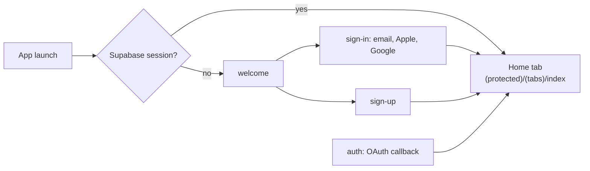
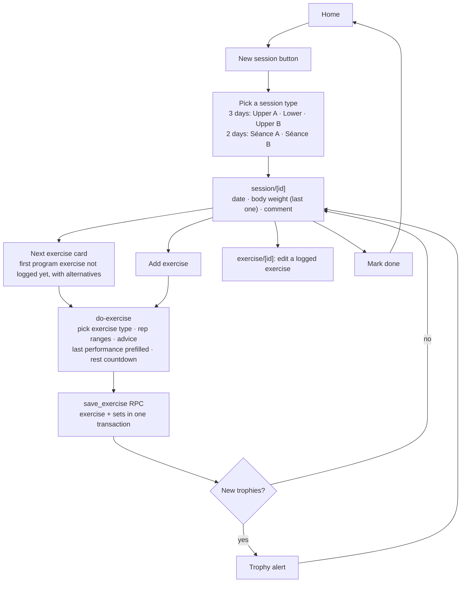
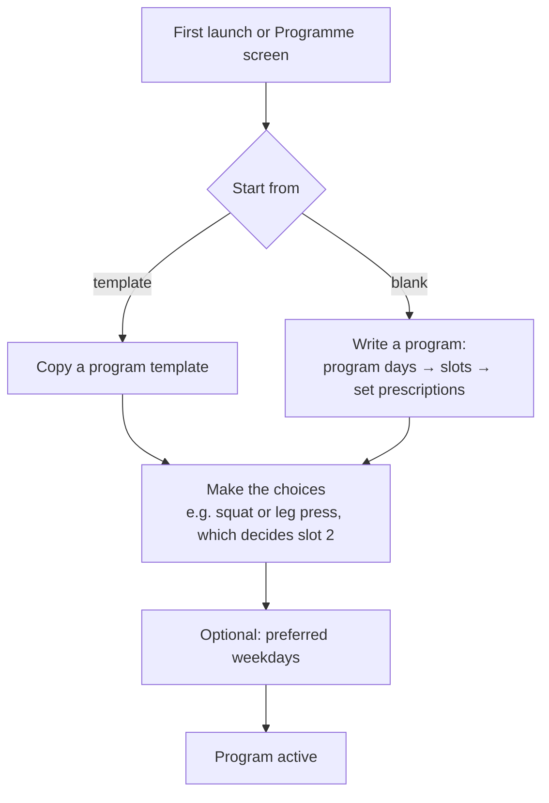
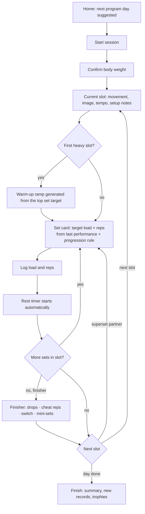
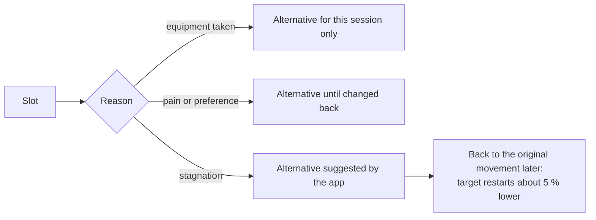

# Flows

How a user moves through the mobile app: first as built today (screens in `apps/mobile/app/`), then the v1 target from [PRODUCT.md](PRODUCT.md) and [ADR-0001](adr/0001-programs-as-data.md). Terms in **bold** are defined in [GLOSSARY.md](../GLOSSARY.md).

## Today

### Sign in

Sign-up runs `private.setup_user` in the database: profile, default exercise types, programs and trophies.

### Train a session

- The exercise picker only lists exercise types tagged with the session's type.
- Sets are typed into up to four columns of reps and weights; the prescription is shown as text (`4-6`, `Top set puis -10 %…`). The app does not compute targets.
- Body weight is copied from the previous session and editable on the session screen.

### Around the sessions

- **Home**: previous session (opens the Séances tab), trophy progress, shortcut to create an exercise type.
- **Séances** tab: list of sessions, newest first.
- **Settings** tab: Mes exercices (exercise library and editor), Stats, Trophées, Timer, Informations (profile), Programme (order and alternatives per session type, saved with `save_program`), feedback, theme, sign out.

## v1 target

### Set up a program

Editing a program never rewrites history: performances belong to movements, and past sessions keep the program day they were done on.

### Train a session

- Validating a set is the main action and starts the rest; the next set's target is already on screen.
- A superset alternates its two slots with the prescribed short rest; a unilateral slot rests after each side.
- With no history on a movement, the set card is in **calibration**: no target, a hint to start light.

### Swap a movement

**Stagnation** is detected on key lifts: the same performance for a set number of sessions. The app suggests the slot's alternative; the lifter accepts or ignores it.

### Track the body (v2)

- Morning body weight, daily, with a weekly average; the last value prefills a session.
- Measurements and progress photos, every few weeks.
- Steps from HealthKit.
